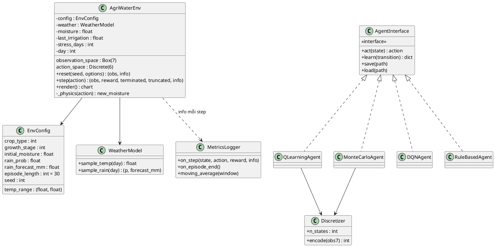
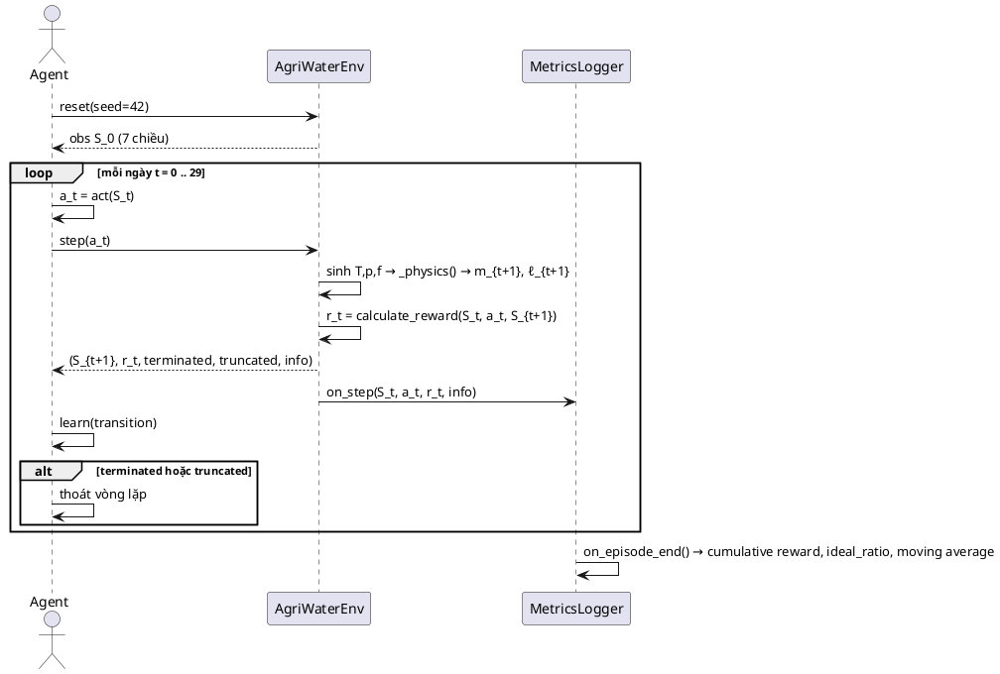

# 3. PHÂN TÍCH MÔI TRƯỜNG THỬ NGHIỆM

> **Đồng bộ theo bản docx V2** (`HocTangCuongN10_HoanChinh.docx`): trạng thái **7 chiều**, **6 hành động** tưới, hàm phần thưởng **6 thành phần**, episode **30 ngày**, 3 kịch bản thời tiết và kiến trúc 4 lớp.

## 3.1. Vị trí của môi trường thử nghiệm trong hệ thống

Môi trường thử nghiệm **AgriWaterEnv** được cài đặt trên thư viện **Gymnasium** và đóng vai trò thành phần **nội bộ** của hệ thống AgriWater-RL (không phải actor). Môi trường có hai chức năng:

1. **Mô phỏng thực tại:** giả lập tương tác vật lý của đất – cây – thời tiết (bốc thoát hơi nước, cây hút nước, mưa ngẫu nhiên, thấm thoát nước) theo từng bước thời gian.
2. **Cung cấp tín hiệu học:** phát bộ `(observation, reward, terminated, truncated, info)` cho agent và cho module Đánh giá hiệu suất (UC-05) ở mỗi bước.

Môi trường là "sân chơi chung" mà cả **4 chiến lược** (Q-Learning, Monte Carlo Control, DQN, Baseline luật cố định) tương tác như nhau — điều kiện cần để so sánh công bằng (cùng mô hình vật lý, cùng hàm phần thưởng, cùng $\gamma = 0.99$).

```text
                        ┌──────────────────────────────────┐
   UC-01 (cấu hình) ──► │        AgriWaterEnv (7D)         │ ◄── UC-03 (kịch bản)
                        │  Box(7) · Discrete(6) · 30 ngày  │
                        └──────────────┬───────────────────┘
                                       │ (S, R, info) mỗi bước
              ┌──────────────┬─────────┴─────────┬──────────────┐
              ▼              ▼                   ▼              ▼
        Q-Learning     MC Control             DQN        Baseline luật
         (bảng Q)     (return đầy đủ)      (mạng 7→128→128→6)  (m ≥ 0.30?)
              └──────────────┴─────────┬─────────┴──────────────┘
                                       ▼
                        UC-05 Đánh giá (nước, stress, ideal ratio, reward)
```

## 3.2. Nhu cầu chức năng của môi trường

| Mã | Nhu cầu chức năng | Mô tả |
|---|---|---|
| FR-ENV-1 | Khởi tạo theo cấu hình | Nhận `EnvConfig` (loại cây, giai đoạn sinh trưởng, độ ẩm ban đầu, dải nhiệt độ, xác suất mưa, lượng mưa dự báo, độ dài episode, seed) — tương ứng form UC-01 |
| FR-ENV-2 | Mô phỏng cân bằng nước | Tính $m_{t+1}$ từ $m_t$, nhiệt độ, mưa, lượng tưới và lượng thấm thoát (công thức mục 3.5) |
| FR-ENV-3 | Sinh nhiệt độ theo kịch bản | Mùa khô (35–42 °C), mùa mưa bão (dao động vừa), kịch bản ngẫu nhiên (phân phối thực tế) |
| FR-ENV-4 | Sinh mưa ngẫu nhiên | Mưa theo phân phối Bernoulli với xác suất $p_t$; lượng mưa $f_t$ theo kịch bản |
| FR-ENV-5 | Tính phần thưởng | Gọi `calculate_reward(S_t, a_t, S_{t+1})` — **tái sử dụng** đúng hàm $R$ của MDP (6 thành phần), không viết lại |
| FR-ENV-6 | Kết thúc episode | `terminated` khi cây chết (stress liên tiếp $K$ ngày); `truncated` khi hết 30 ngày |
| FR-ENV-7 | Cung cấp log cho UC-05 | Mỗi bước đưa vào `info`: lượng nước tưới, cờ stress, độ ẩm, giai đoạn sinh trưởng |
| FR-ENV-8 | Render tối thiểu | Vẽ chuỗi độ ẩm theo thời gian phục vụ UC-06 |

## 3.3. Nhu cầu phi chức năng

| Mã | Nhu cầu | Tiêu chí đo |
|---|---|---|
| NFR-1 | **Tái lập được** | Cùng seed ⇒ cùng chuỗi nhiệt độ/mưa/trajectory; `reset(seed=42)` hai lần cho kết quả bitwise giống nhau |
| NFR-2 | **Tốc độ** | ≥ 10.000 bước/giây trên máy phổ thông (đủ cho DQN huấn luyện hàng trăm nghìn bước) |
| NFR-3 | **Tuân thủ chuẩn Gymnasium** | Đúng signature `reset/step`, trả 5 phần tử, khai báo đúng `observation_space`/`action_space` |
| NFR-4 | **Tách bạch kịch bản** | Đổi kịch bản **không sửa code env** — chỉ nạp `WeatherModel` khác từ JSON |
| NFR-5 | **Không phụ thuộc thuật toán** | Env không import bất kỳ module agent nào (quan hệ một chiều) |
| NFR-6 | **Hỗ trợ cả hai dạng trạng thái** | Trả vector 7 chiều đã chuẩn hóa $[0,1]$ (cho DQN) mà vẫn rời rạc hóa được (cho Q-Learning/MC) |

## 3.4. Đầu vào – xử lý – đầu ra

| Thành phần | Chi tiết |
|---|---|
| **Đầu vào** | • `action` $a_t \in \{0,\dots,5\}$ tương ứng $\{0,5,10,15,20,25\}$ lít<br>• `EnvConfig`: crop_type, growth_stage, initial_moisture ∈ [0,1], temp_range ∈ [15,45] °C, rain_prob, rain_forecast_mm, episode_length = 30, seed<br>• `WeatherModel` nạp theo UC-03 |
| **Xử lý** | 1. Sinh $T_t$, $p_t$, $f_t$ từ `WeatherModel` (theo seed)<br>2. Quy đổi action → thể tích nước (L) → độ tăng ẩm $\Delta I$<br>3. Cập nhật $m_{t+1}$ theo cân bằng nước (3.5)<br>4. $r_t = $ `calculate_reward(S_t, a_t, S_{t+1})`<br>5. Cập nhật `last_irrigation`, kiểm tra điều kiện dừng |
| **Đầu ra** | • `observation`: `np.float32[7]`, mọi chiều chuẩn hóa $[0,1]$<br>• `reward`: float (6 thành phần)<br>• `terminated`: bool (cây chết do stress liên tiếp)<br>• `truncated`: bool (hết 30 ngày)<br>• `info`: `{water_L, crop_stress, moisture, growth_stage, ideal}` |

**Khai báo không gian với Gymnasium:**

```python
observation_space = Box(
    low   = np.zeros(7, dtype=np.float32),
    high  = np.ones(7,  dtype=np.float32),
    dtype = np.float32,
)   # [crop_type, growth_stage, soil_moisture, temperature,
    #  rain_probability, rain_forecast_mm, last_irrigation]  (đã chuẩn hóa)

action_space = Discrete(6)   # 0,5,10,15,20,25 lít
```

> **Quy ước chuẩn hóa:** `crop_type` và `growth_stage` chuẩn hóa bằng $x/(K-1)$ và $g/(M-1)$; `temperature` Min-Max theo $[15,45]$; `rain_forecast_mm` chia $R_{\max} = 50$ mm; `last_irrigation` lấy theo tỷ lệ so với 25 L.
>
> **Hệ quả quan trọng:** do trạng thái đã chuẩn hóa, ngưỡng trong hàm reward phải đọc từ giá trị **đã chuẩn hóa**. Cụ thể `rain_forecast_mm ≥ 0.30` trong mã giả tương đương **15 mm**, và `last_irrigation ≥ 0.50` tương đương **≥ 12,5 L**.

## 3.5. Mô hình vật lý nền (cân bằng nước tầng rễ)

$$m_{t+1} = \operatorname{clip}\Big( m_t \;+\; \underbrace{\eta \cdot k_a \cdot a_t}_{\Delta I\ \text{(tưới)}} \;+\; \underbrace{\rho \cdot f_t}_{\Delta R\ \text{(mưa)}} \;-\; \underbrace{ET_t}_{\text{bốc thoát hơi}} \;-\; \underbrace{D_t}_{\text{thấm thoát}},\; 0,\; 1 \Big)$$

$$ET_t = c_{\text{evap}} \cdot K_c(\text{crop},\ g) \cdot \frac{T_t - 15}{30} + c_{\text{base}}, \qquad D_t = \max\big(0,\ m_t - \theta_{\text{fc}}\big)$$

> **Cập nhật 27/10/2026 (đã chốt — phương án B):** thấm thoát tính từ **nước đọng của ngày trước**, `D_t = max(0, m_t − θ_fc)`. Công thức cũ `max(0, m_t + ΔI + ΔR − θ_fc)` khiến `m_{t+1} ≤ θ_fc − ET < 0.85`, nên nhánh stress ngập úng `m > 0.85` không bao giờ xảy ra. Với công thức mới, nước tưới/mưa trong ngày có thể đẩy `m` vượt 0.85 — khớp với reward và kịch bản mưa bão. Quyết định ghi ở `CONTEXT.md` §15; `contract.py` và `reward.py` không đổi.

| Hằng số | Giá trị đề xuất | Ý nghĩa |
|---|---|---|
| $k_a$ | 0.02 / Lít | Mỗi lít nước tưới bổ sung 2% độ ẩm hữu dụng (action 5 = 25 L ⇒ +50%) |
| $\eta$ | 0.9 | Hiệu suất thấm của vòi tưới |
| $\rho$ | $f_t/R_{\max}$, tối đa 0.35 | Tỷ lệ lượng mưa dự báo chuyển thành độ ẩm tầng rễ |
| $c_{\text{evap}}$ | 0.05 /ngày | Hệ số bốc hơi cơ sở, tăng theo $(T-15)/30$ |
| $c_{\text{base}}$ | 0.010 /ngày | Thoát hơi nền của cây |
| $K_c(\cdot)$ | 0.7 (cây con), 1.0 (thân lá), 1.25 (ra hoa/kết trái), 0.8 (sắp thu hoạch) | Hệ số cây trồng theo giai đoạn (FAO-56 rút gọn) |
| $\theta_{\text{fc}}$ | 0.85 | Sức chứa ẩm đồng ruộng; vượt ngưỡng ⇒ thấm thoát $D_t$ |

**Ngưỡng an toàn sinh học:** héo vĩnh viễn $m < 0.20$; vùng lý tưởng $[0.40, 0.70]$ (giai đoạn ra hoa $[0.50, 0.75]$); ngập úng $m > 0.85$.

**Điều kiện kết thúc:**
- `truncated = True` khi $t$ đủ **30 ngày** (kết thúc vụ mùa mô phỏng).
- `terminated = True` khi $m$ nằm ngoài vùng an toàn ( $<0.20$ hoặc $>0.85$ ) trong **$K = 3$ ngày liên tiếp** ⇒ cây chết, episode dừng.

**Mưa:** $z_t \sim \text{Bernoulli}(p_t)$; nếu $z_t = 1$ thì lượng mưa thực tế $f_t$ lấy quanh `rain_forecast_mm` (có nhiễu), ngược lại $f_t = 0$. Đây là điểm buộc agent phải **nhìn xa**: khi $p_t$ và $f_t$ cao, hành động khôn ngoan là không tưới và chờ mưa.

## 3.6. Ràng buộc và phụ thuộc

| Loại | Nội dung |
|---|---|
| **Ràng buộc trạng thái** | Mọi chiều luôn nằm trong $[0,1]$ nhờ `clip()`; `crop_type`/`growth_stage` là hằng số trong một episode |
| **Ràng buộc hành động** | Rời rạc, `Discrete(6)` — giá trị ngoài miền bị Gymnasium chặn |
| **Phụ thuộc thời gian** | $m_{t+1}$ phụ thuộc $m_t$ và `last_irrigation` ⇒ cần đưa `last_irrigation` vào trạng thái để giữ tính Markov (bù độ trễ thẩm thấu) |
| **Phụ thuộc reward** | Reward phụ thuộc $m_t$, $m_{t+1}$, $p_t$, $f_t$, $\ell_t$ và $g_{t+1}$ ⇒ env phải giữ trạng thái **trước** khi cập nhật |
| **Phụ thuộc seed** | Toàn bộ ngẫu nhiên (nhiệt độ, mưa) đi qua `np_random` của Gymnasium, không dùng `random`/`np.random` toàn cục |

## 3.7. Kịch bản thử nghiệm (UC-03)

| Kịch bản | $p_t$ (xác suất mưa) | $T_t$ (°C) | $f_t$ | Mục đích kiểm thử |
|---|---|---|---|---|
| **Khô hạn (dry)** | 0.05 | 35–42 | nhỏ | Cây dễ stress; đo khả năng cứu cây và tiết kiệm nước |
| **Mưa bão (stormy)** | 0.50–0.80 | 22–30 | lớn (≥ 15 mm) | Đo khả năng hoãn tưới, tận dụng nước mưa, tránh ngập úng |
| **Ngẫu nhiên (randomized)** | 0.20–0.60 | 20–38 | theo phân phối | Đánh giá khả năng tổng quát hóa trên điều kiện chưa gặp |
| **Đa seed** | như trên, seed 1…10 | — | — | Lấy trung bình, tránh kết quả do may mắn |

Kịch bản mô tả bằng **tập tin JSON** nạp vào `WeatherModel` (không hard-code trong env) — đúng NFR-4:

```json
{
  "name": "dry",
  "rain_prob": 0.05,
  "temp_range": [35.0, 42.0],
  "rain_forecast_range": [0.0, 0.1],
  "episode_length": 30,
  "crop_type": 0,
  "growth_stage": 2,
  "seed": 42
}
```

## 3.8. Giả định và rủi ro

| # | Giả định | Rủi ro nếu sai | Biện pháp giảm thiểu |
|---|---|---|---|
| 1 | Mưa là Bernoulli độc lập theo ngày | Mưa thực tế có tính mùa mạnh hơn | `WeatherModel` có thể nâng cấp thành chuỗi Markov mưa mà không sửa env (NFR-4) |
| 2 | $ET$ tuyến tính theo nhiệt độ, $K_c$ theo bảng FAO-56 rút gọn | Mô hình lệch thực tế | Hệ số đóng gói trong `EnvConfig`, tinh chỉnh không sửa code lõi |
| 3 | Tưới cộng dồn tuyến tính theo thể tích | Không phản ánh bão hòa | Thêm hàm bão hòa và $D_t$ (thấm thoát) trong `_physics()` — vẫn giữ nguyên API |
| 4 | Reward 6 thành phần đủ định hình hành vi | Agent tối ưu thưởng nhưng hại cây | Kiểm chứng bằng **5 tình huống mẫu** của MDP chạy trên env thật (unit test) |
| 5 | Trạng thái 7 chiều đủ thông tin (Markov) | Hiện tượng trễ thẩm thấu vẫn còn | `last_irrigation` đóng vai "bộ nhớ ngắn hạn"; nếu cần, mở rộng thêm chiều thay vì sửa lõi |

---

# 4. THIẾT KẾ KIẾN TRÚC MÔI TRƯỜNG THỬ NGHIỆM

## 4.1. Kiến trúc tổng thể (4 lớp)

```text
┌──────────────────────────── Presentation Layer ────────────────────────────┐
│  Streamlit: cấu hình kịch bản · learning curves · bảng so sánh · xuất PDF   │
└───────────────────────────────────▲────────────────────────────────────────┘
┌──────────────────────────── Application Layer ─────────────────────────────┐
│  Experiment Manager (kịch bản) · Comparator (chạy đối chứng) · Report Gen. │
└───────────────────────────────────▲────────────────────────────────────────┘
┌──────────────────────── RL & Simulation Layer (lõi) ───────────────────────┐
│   ┌─────────────────────────┐        ┌──────────────────────────────────┐  │
│   │  AgriWaterEnv (7D, 6A)  │ obs,r  │  Agent Pipeline                  │  │
│   │  · soil water balance   │ ─────► │  Q-Learning | MC | DQN | Rule    │  │
│   │  · ET, rain, drainage   │ ◄───── │  (Agent API thống nhất)          │  │
│   │  · calculate_reward()   │ action │                                  │  │
│   └───────────┬─────────────┘        └────────────────┬─────────────────┘  │
│               │ info (water, stress, ideal)           │ checkpoint          │
│               ▼                                       ▼                    │
│        MetricsLogger (UC-05)                    checkpoints/*.pt, *.npz     │
└────────────────────────────────────────────────────────────────────────────┘
┌──────────────────────────── Data & Storage Layer ──────────────────────────┐
│  Q-Table (.npz) · Replay Buffer · Configs (.json) · Logs (.csv)            │
└────────────────────────────────────────────────────────────────────────────┘
```

| Module | Trách nhiệm | Tương ứng |
|---|---|---|
| **AgriWaterEnv** | Mô phỏng vật lý, sinh $(S, R)$ 7 chiều | FR-ENV-1…8 |
| **WeatherModel** | Sinh kịch bản thời tiết từ JSON | UC-03, UC-01 (A-1) |
| **reward.py** | Một nguồn sự thật duy nhất cho $R(s,a)$ | FR-ENV-5, C6, C7 |
| **Agent Pipeline** | 4 chiến lược tuân chung Agent API | UC-02, UC-03 |
| **MetricsLogger** | Bắt $(S,A,R)$, tính metric, xuất CSV | UC-05 |

**Quan hệ bắt buộc:** Env →(không phụ thuộc)→ Agent (NFR-5).

## 4.2. Sơ đồ lớp



## 4.3. Quy ước API Gymnasium

```text
reset(seed=None, options=None) -> (observation, info)
  observation : np.float32[7] đã chuẩn hóa [0,1]
  info        : dict rỗng ở đầu episode
  nội bộ      : day ← 0 ; stress_days ← 0 ; last_irrigation ← 0
                moisture ← config.initial_moisture ; WeatherModel.seed(seed)

step(action) -> (observation, reward, terminated, truncated, info)
  1. water_L ← WATER_LEVELS[action]                # [0,5,10,15,20,25]
  2. đọc T_t, p_t, f_t từ WeatherModel theo day
  3. m_next ← _physics(action, T_t, f_t)           # công thức 3.5
  4. reward ← calculate_reward(S_t, action, S_{t+1})    # 6 thành phần
  5. cập nhật last_irrigation, stress_days, day
  6. terminated ← stress_days ≥ K (=3)
     truncated  ← day ≥ episode_length (=30)
  7. trả (obs = normalize([crop, stage, m_next, T, p, f, ℓ]), reward,
          terminated, truncated, info)
     info = {"water_L": water_L, "crop_stress": bool, "moisture": m_next,
             "growth_stage": g, "ideal": 0.40 ≤ m_next ≤ 0.70}
```

**Quy ước quan trọng:**
- Reward gọi đúng `calculate_reward()` — **một nguồn sự thật duy nhất**, tránh hai phiên bản lệch nhau.
- `info["water_L"]` là đơn vị cho metric "tổng lượng nước tiêu thụ" của UC-05.
- `obs` sau mỗi bước dùng **dự báo của ngày kế tiếp** ($T_{t+1}, p_{t+1}, f_{t+1}$) — agent cần dự báo để quyết định hôm nay, không phải thời tiết đã xảy ra.

## 4.4. Luồng dữ liệu cho UC-05

```text
Mỗi bước env.step(a):
   Env ──► info{water_L, crop_stress, moisture, ideal}
             │
             ▼
   MetricsLogger.on_step(state, action, reward, info)
             │  water_total ← += water_L
             │  stress_count ← += crop_stress
             │  ideal_count  ← += ideal
             │  reward_series ← append(reward)   (buffer chống nghẽn I/O — E-1)
             ▼
   Cuối episode: on_episode_end()
             │  cumulative_reward, ideal_ratio, moving_average(50)
             ▼
   Kho đánh giá (CSV/SQLite) ──► Dashboard UC-06
```

Thiết kế buffer gom theo block chính là cài đặt trực tiếp cho ngoại lệ **E-1 (nghẽn cổ chai I/O)** của UC-05.

## 4.5. Cấu trúc thư mục dự kiến

```text
agriwater/
├── env/
│   ├── agriwater_env.py       # AgriWaterEnv (Gymnasium, 7D/6A)
│   ├── weather_model.py       # WeatherModel + nạp ScenarioFile (JSON)
│   ├── config.py              # EnvConfig, hằng số vật lý, WATER_LEVELS
│   └── reward.py              # calculate_reward() — 6 thành phần
├── agents/
│   ├── base.py                # AgentInterface
│   ├── registry.py            # đăng ký thuật toán (pipeline cắm – chạy)
│   ├── discretizer.py         # rời rạc hóa dùng chung Q-Learning & MC (480 trạng thái)
│   ├── q_learning.py
│   ├── mc_control.py          # Monte Carlo Control (on-policy, first-visit)
│   ├── dqn.py                 # mạng 7 → 128 → 128 → 6
│   └── rule_based.py          # Baseline: m < 0.30 → tưới 20 L
├── eval/
│   └── metrics_logger.py
├── scenarios/
│   ├── dry.json
│   ├── stormy.json
│   └── randomized.json
├── tests/
│   ├── test_reward.py         # 5 tình huống: +6, +10, −124, −4, −10
│   ├── test_env_api.py        # check_env, kiểu trả về, biên obs
│   ├── test_determinism.py    # NFR-1
│   ├── test_physics.py        # cân bằng nước, clip, terminated/truncated
│   └── test_no_agent_import.py
├── train.py                   # UC-02 (--algorithm, --seed, --episodes)
└── evaluate.py                # UC-03/UC-04 (đa kịch bản, đa seed, xuất CSV)
```

Thêm chiến lược mới ⇒ thêm 1 file trong `agents/` + 1 dòng đăng ký; thêm kịch bản ⇒ thêm 1 file JSON. **Không sửa env.**

## 4.6. Giao diện chung của Agent

```text
AgentInterface
  act(state)        — trả action; Baseline dùng if-else, các agent RL dùng ε-greedy (ε=0 khi đánh giá)
  learn(transition) — transition = (S, a, r, S', done, truncated)
                      · Q-Learning: cập nhật TD(0) từng bước
                      · MC: đẩy vào buffer episode, cập nhật khi episode kết thúc
                      · DQN: đẩy vào Replay Buffer, học theo mini-batch
                      · Baseline: hàm rỗng
  save(path)/load(path) — checkpoint (A-1 UC-02, bước nạp mô hình của UC-03)
```

> Lưu ý ngữ nghĩa: `done` trong `learn()` phải tách **`terminated`** và **`truncated`**. Q-Learning/DQN chỉ bootstrap khi `truncated`; MC dùng return đầy đủ đến hết episode trong cả hai trường hợp. Gộp chung một cờ `done` sẽ làm agent học "sau khi cây chết vẫn còn giá trị".

## 4.7. Luồng dữ liệu một episode



## 4.8. Thiết kế mở rộng trong tương lai

| Hướng mở rộng | Nơi cắm | Không cần sửa |
|---|---|---|
| Thêm thuật toán RL (PPO, SAC) | File mới trong `agents/` + đăng ký | Env, Logger, train/evaluate |
| Mưa theo mùa / El Niño | `WeatherModel` (chuỗi Markov mưa) + JSON | `AgriWaterEnv` |
| Mô hình đất nhiều tầng, nhiều loại cây | `_physics()` + `K_c` trong `EnvConfig` | API `reset/step` |
| Kết nối IoT cảm biến thực | Adapter đọc sensor → chuẩn hóa thành obs 7 chiều | Agent đã huấn luyện chạy nguyên vẹn |
| Rời rạc hóa mịn hơn cho thuật toán bảng | `Discretizer` (từ 480 lên 4.320 trạng thái) | Env, reward |

Điểm mấu chốt: **API `reset/step` của Gymnasium là hợp đồng ổn định duy nhất** giữa môi trường và phần còn lại. Mọi mở rộng nằm sau ranh giới đó.

---

## 4.9. Kiểm thử bắt buộc của môi trường

| # | Test | Kỳ vọng |
|---|---|---|
| T1 | `gymnasium.utils.env_checker.check_env` | Pass, không cảnh báo |
| T2 | Tái lập: `reset(seed=42)` × 2 + cùng chuỗi hành động 1.000 bước | Mảng obs/reward/terminated/truncated giống tuyệt đối |
| T3 | Tốc độ 100.000 bước | ≥ 10.000 bước/giây |
| T4 | Reward 5 tình huống MDP | $+6$, $+10$, $-124$, $-4$, $-10$ |
| T5 | Vật lý: $a=0$ ở 42 °C ⇒ $m$ giảm; $a=5$ từ 0.9 ⇒ clip 1.0; vượt $\theta_{fc}$ ⇒ có $D_t$ | Pass các assert |
| T6 | Kết thúc: 3 ngày liên tiếp $m<0.20$ ⇒ `terminated`; 30 ngày ⇒ `truncated` | Đúng cờ, không lẫn nhau |
| T7 | Không import agent trong `env/` | `grep` không có kết quả |

*Tài liệu mô tả môi trường ở mức cài đặt trực tiếp; các hằng số vật lý là đề xuất, nhóm tinh chỉnh sau khi kiểm chứng trên env thật nhưng **không đổi API**.*
