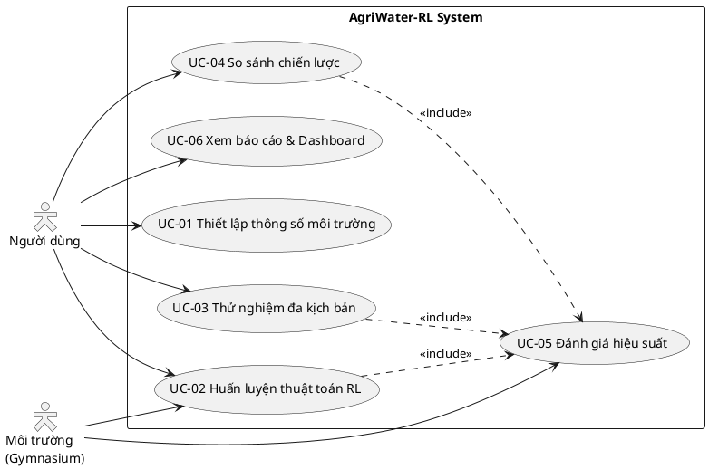

**TRƯỜNG ĐẠI HỌC THỦY LỢI**

**KHOA CÔNG NGHỆ THÔNG TIN**

**MÔN: HỌC TĂNG CƯỜNG VÀ ỨNG DỤNG**

**Đề tài:**

**HỆ THỐNG RA QUYẾT ĐỊNH TƯỚI TIÊU TỰ ĐỘNG**

**TỐI ƯU HÓA NGUỒN NƯỚC TRONG NÔNG NGHIỆP**

**Nhóm sinh viên thực hiện:** Nhóm 10

**Thành viên nhóm:**

| STT | Họ và tên | Lớp | MSSV |
|---|---|---|---|
| 1 | Nguyễn Minh | 65KTPM | 235117060 |
| 2 | Nguyễn Thị Phương Thảo | 65KTPM | 2351170621 |
| 3 | Nguyễn Thế Trưởng | 65KTPM | 2351170626 |
| 4 | Lục Văn Thuận | 65KTPM | 2351170624 |
| 5 | Vũ Tuấn Khanh | 64KTPM4 | 2251172386 |

**Giảng viên phụ trách môn học:** Lê Nguyễn Tuấn Thành

Hà Nội, năm 2026

> **Ghi chú đồng bộ:** tài liệu này được cập nhật theo bản `HocTangCuongN10_HoanChinh.docx` (V2): trạng thái **7 chiều**, **6 hành động** tưới, hàm phần thưởng **6 thành phần**, episode **30 ngày**, 3 kịch bản thời tiết và kiến trúc 4 lớp. Bổ sung mới so với docx V2: thuật toán **Monte Carlo Control** (mục 7.3).

---

# 1. GIỚI THIỆU BÀI TOÁN

Hiện nay nông nghiệp tiêu tốn một lượng nước khổng lồ, nhưng các hệ thống tưới tiêu hiện có (tưới hẹn giờ cố định hoặc bơm tự động theo cảm biến tĩnh) quá cứng nhắc: chúng chỉ giải quyết vấn đề tức thời, thiếu khả năng đánh giá dài hạn và không linh hoạt theo thời tiết. Hệ quả là lãng phí tài nguyên nước, hoặc tưới không đúng thời điểm làm giảm năng suất cây trồng.

Hệ thống AgriWater-RL đóng vai trò một kỹ sư nông nghiệp tự động, trả lời câu hỏi: *"Nên tưới vào lúc nào và tưới bao nhiêu nước?"*. Mục tiêu cuối cùng là tìm điểm cân bằng giữa hai yếu tố đối lập: **tiết kiệm nước tối đa** và **đảm bảo cây sinh trưởng lý tưởng**.

## 1.1. Các mục tiêu chính

- **Phát triển hệ thống tưới tiêu tự động:** thiết kế và mô phỏng hệ thống tưới trong môi trường Gymnasium, ra quyết định cấp nước tự động không cần can thiệp của con người.
- **Tối ưu hóa nguồn tài nguyên nước:** nhận diện và xử lý các thông số môi trường (độ ẩm, thời tiết, dự báo mưa) để đưa ra hành động tưới phù hợp, tiết kiệm và hiệu quả.
- **Áp dụng học tăng cường:** huấn luyện tác tử học từ trải nghiệm, ra quyết định tối ưu dựa trên phần thưởng và hình phạt.
- **Mô phỏng và đánh giá:** đánh giá hiệu quả qua khả năng duy trì độ ẩm lý tưởng, tổng lượng nước tiêu thụ và tốc độ hội tụ của thuật toán.
- **Tích hợp và tối ưu hóa:** thử nghiệm và tinh chỉnh siêu tham số để hệ thống hoạt động ổn định, đạt hiệu suất cao nhất.

## 1.2. Công nghệ, nền tảng dự kiến sử dụng

- **Gymnasium (OpenAI Gym):** thư viện mã nguồn mở cho mô phỏng môi trường RL; cung cấp API chuẩn `reset()/step()` để mô phỏng tương tác vật lý của độ ẩm đất và hệ thống tưới.
- **Thuật toán học tăng cường:** Tabular Q-Learning, Deep Q-Network (DQN) và Monte Carlo Control.
- **Python / PyTorch:** ngôn ngữ lập trình chính và framework học sâu cho DQN.
- **Trực quan hóa:** Streamlit (dashboard), Matplotlib (biểu đồ huấn luyện).

---

# 2. TÍNH NĂNG PHẦN MỀM

Dự án AgriWater-RL gồm **6 tính năng chính**, bao quát 4 mục tiêu của môn học (Tích hợp – Thử nghiệm – So sánh – Đánh giá):

1. **Tích hợp mô phỏng nông nghiệp (Integrate):** khởi tạo Environment bằng Gymnasium, mô phỏng bốc thoát hơi nước, mưa ngẫu nhiên và mức tiêu thụ nước của cây.
2. **Tích hợp đa thuật toán (Integrate):** pipeline cho phép cắm – chạy các thuật toán RL khác nhau: Q-Learning, DQN, Monte Carlo Control (kèm cơ chế đăng ký thuật toán mới).
3. **Thử nghiệm đa kịch bản (Experiment):** cấu hình linh hoạt điều kiện môi trường (khô hạn, mưa bão, ngẫu nhiên), thay đổi seed và siêu tham số.
4. **So sánh chiến lược (Compare):** đối chiếu các thuật toán RL với Baseline luật cố định trên cùng kịch bản và cùng seed.
5. **Đánh giá hiệu suất tổng thể (Evaluate):** tự động đo tổng lượng nước tiêu thụ, chỉ số sức khỏe cây, reward tích lũy, thời gian hội tụ.
6. **Báo cáo và Dashboard (Evaluate):** trực quan hóa biến thiên độ ẩm theo thời gian thực và trích xuất bảng/biểu đồ so sánh, xuất CSV/PDF.

---

# 3. PHÂN TÍCH BÀI TOÁN

## 3.1. Biểu đồ phân rã chức năng

Hệ thống gồm 5 nhóm chức năng chính:

1. **Quản lý mô phỏng môi trường nông nghiệp**
   - 1.1. Khởi tạo môi trường tưới tiêu: thiết lập thông số ban đầu (loại đất, cây trồng, dung tích chứa nước) và API kết nối Agent ↔ môi trường.
   - 1.2. Mô phỏng bốc thoát hơi nước và mưa: giả lập hao hụt ẩm do nhiệt độ và các đợt mưa tự nhiên theo phân phối xác suất.
   - 1.3. Cập nhật biến thiên trạng thái: tính lại độ ẩm đất, nhiệt độ, `rain_probability`, `rain_forecast_mm` và lịch sử tưới `last_irrigation` sau mỗi bước.
2. **Quản lý thuật toán ra quyết định tưới AI**
   - 2.1. Thực thi thuật toán quy tắc cố định (Baseline).
   - 2.2. Huấn luyện & thực thi Q-Learning (bảng Q trên không gian rời rạc).
   - 2.3. Huấn luyện & thực thi DQN (Replay Buffer + Target Network).
   - 2.4. Đăng ký & tích hợp thuật toán mới (plugin theo giao diện chuẩn).
3. **Quản lý kịch bản & cấu hình thử nghiệm**
   - 3.1. Thiết lập kịch bản khắc nghiệt (hạn hán, nắng gắt, mưa bão dồn dập).
   - 3.2. Cấu hình tham số học và thông số kỹ thuật hệ thống bơm.
   - 3.3. Quản lý hồ sơ thử nghiệm (profile + random seed) để tái lập kết quả.
4. **Thực thi so sánh & chạy đối chứng**
   - 4.1. Khởi chạy song song đa chiến lược trên cùng kịch bản.
   - 4.2. Ghi nhận chuỗi dữ liệu tương tác $(S, A, R)$.
   - 4.3. Quản lý phiên thử nghiệm đối kháng, kiểm soát điều kiện công bằng.
5. **Đánh giá hiệu năng & báo cáo trực quan**
   - 5.1. Đo lượng nước và điện năng tiêu thụ.
   - 5.2. Đánh giá chỉ số an toàn sức khỏe cây (tỷ lệ thời gian trong vùng tối ưu 40%–70%, số lần vi phạm ngưỡng nguy hiểm).
   - 5.3. Phân tích độ hội tụ và ổn định chính sách (cumulative reward, loss, số episode hội tụ).
   - 5.4. Trực quan hóa tiến trình mô phỏng thời gian thực.
   - 5.5. Trích xuất báo cáo tổng hợp CSV/PDF.

## 3.2. Biểu đồ use case tổng quát



**Bảng tổng hợp use case:**

| Mã | Tên use case | Tác nhân | Ưu tiên |
|---|---|---|---|
| UC-01 | Thiết lập thông số môi trường | Người dùng | Cao |
| UC-02 | Huấn luyện thuật toán RL | Người dùng, Môi trường | Rất cao |
| UC-03 | Thử nghiệm đa kịch bản | Người dùng, Môi trường | Cao |
| UC-04 | So sánh chiến lược | Người dùng | Cao |
| UC-05 | Đánh giá hiệu suất | Môi trường | Rất cao |
| UC-06 | Xem báo cáo & Dashboard | Người dùng | Trung bình |

## 3.3. Đặc tả use case

**UC-01 — Thiết lập thông số môi trường.** Người dùng mở form nhập 7 thành phần của vector trạng thái: `CropType` (int, $[0,K-1]$), `GrowthStage` (int, $[0,M-1]$), `SoilMoisture` (float, $[0,1]$), `Temperature` (float, $[15,45]$ °C), `RainProb` (float, $[0,1]$), `RainForecastMM` (float, $[0,R_{\max}]$), `LastIrrigation` (float, $[0,1]$). Hệ thống kiểm tra ràng buộc, lưu cấu hình và thông báo thành công. *Luồng con A-1:* tải lên tệp kịch bản có sẵn và tự động map thông số vào form. *Ngoại lệ E-1:* dữ liệu sai định dạng/vượt ngưỡng ⇒ bôi đỏ ô lỗi, khóa nút "Lưu thiết lập".

**UC-02 — Huấn luyện thuật toán RL.** Người dùng chọn thuật toán trong dropdown (**Q-Learning / DQN / Monte Carlo Control**), nhập $\alpha$, $\gamma$ (mặc định 0.99) và `total_timesteps`, rồi bấm "Bắt đầu Huấn luyện". Hệ thống kiểm tra tham số, khóa giao diện, hiển thị progress bar; Agent liên tục chọn hành động $a \in \{0,1,2,3,4,5\}$ và nhận $(S, R)$ từ môi trường (gọi ngầm UC-05 để ghi log). Kết thúc: thông báo "Huấn luyện hoàn tất" và lưu mô hình. *A-1:* nút "Dừng Huấn luyện" ⇒ ngắt tiến trình và lưu checkpoint. *E-1:* tham số không hợp lệ ⇒ chặn huấn luyện. *E-2:* tràn RAM ⇒ dừng, báo lỗi, khôi phục giao diện.

**UC-03 — Thử nghiệm đa kịch bản.** Người dùng tải lên tập kịch bản thời tiết và chọn mô hình đã huấn luyện; hệ thống nạp mô hình, kiểm tra số chiều trạng thái, chạy mô phỏng và ghi nhận kết quả qua UC-05. *A-1:* chọn `Rule-based` để chạy Baseline. *E-1:* không gian trạng thái không khớp ⇒ báo "Lỗi kịch bản: Thông số trạng thái môi trường không khớp".

**UC-04 — So sánh chiến lược.** Người dùng chọn từ 2 nguồn dữ liệu trở lên (có thể thêm chiến lược thứ 3, 4 bằng nút `+`), hệ thống đồng bộ chuỗi thời gian, tổng hợp chênh lệch về lượng nước và sức khỏe cây, xuất báo cáo đối chiếu. *E-1:* độ dài chuỗi không đồng nhất ⇒ tự động cắt theo tập ngắn nhất và cảnh báo.

**UC-05 — Đánh giá hiệu suất (chạy ngầm).** Môi trường phát $(S,A,R)$ mỗi bước; hệ thống cộng dồn tổng nước, số lần stress, số lần tưới sai thời điểm, cumulative reward; tự động tính trung bình trượt (moving average) và lưu định kỳ. *E-1:* nghẽn I/O ⇒ bật chế độ buffer, gom theo block.

**UC-06 — Xem báo cáo & Dashboard.** Người dùng chọn khoảng thời gian và loại biểu đồ; hệ thống truy xuất kho dữ liệu và render biểu đồ (đường cong reward, loss, độ ẩm theo thời gian). *A-1:* xuất báo cáo PDF. *E-1:* kho dữ liệu trống ⇒ thông báo "Không có dữ liệu để hiển thị".

## 3.4. Kiến trúc hệ thống (4 lớp)

Hệ thống được module hóa, cho phép mở rộng từ **không gian trạng thái 3 chiều ban đầu lên 7 chiều** mà không thay đổi cấu trúc tổng thể:

| Lớp | Thành phần | Trách nhiệm |
|---|---|---|
| **Presentation** | Streamlit Dashboard | Cấu hình tham số, theo dõi huấn luyện, trực quan hóa so sánh |
| **Application** | Experiment Manager, Comparator, Report Generator | Quản lý kịch bản, điều phối chạy đối chứng, xuất CSV/PDF |
| **RL & Simulation** | `AgriWaterEnv`, Agents Module | Lõi: động lực học nông nghiệp + thuật toán ra quyết định |
| **Data & Storage** | Q-Table, Replay Buffer, Checkpoints, Logs, Configs | Lưu trữ và bảo đảm tái lập kết quả |

**RL & Simulation Layer:** `AgriWaterEnv` xây dựng trên chuẩn Gymnasium API, trả về **vector trạng thái 7 chiều** (thông tin sinh học cây trồng, điều kiện đất, thời tiết và lịch sử can thiệp) — nhờ đó phản ánh đúng nhu cầu nước của cây và tránh tưới dư thừa. Với không gian 7 chiều, **DQN giữ vai trò chủ đạo** (7 node đầu vào); **Tabular Q-Learning** được giữ làm baseline đơn giản với mức rời rạc hóa mạnh; **Monte Carlo Control** bổ sung nhánh thuật toán học theo episode; PPO/SAC được thiết kế sẵn để cắm vào qua cơ chế đăng ký thuật toán.

---

# 4. PHÂN CÔNG CÔNG VIỆC

| Thành viên | Nhiệm vụ |
|---|---|
| **Nguyễn Thị Phương Thảo** | Xây dựng biểu đồ phân rã chức năng; mô hình hóa MDP (xác định trạng thái $S$); điều phối, review reward và tinh chỉnh siêu tham số |
| **Nguyễn Minh** | Xây dựng biểu đồ use case; mô hình hóa MDP (hàm phần thưởng $R$); cài đặt **Q-Learning** và **Monte Carlo Control** |
| **Nguyễn Thế Trưởng** | Xây dựng kiến trúc hệ thống; mô hình hóa MDP (ma trận chuyển đổi $P$, hành động $A$); **triển khai môi trường `AgriWaterEnv`** |
| **Lục Văn Thuận** | Mô hình hóa MDP (hệ số chiết khấu $\gamma$, mục tiêu MDP); cài đặt **DQN**; module đánh giá & tổng hợp báo cáo |
| **Vũ Tuấn Khanh** | Cài đặt **Baseline luật cố định**; hỗ trợ đánh giá đa kịch bản |

> *Ghi chú:* `requirements.md` hiện chốt danh sách 4 thành viên, trong khi docx V2 ghi nhận 5 thành viên (thêm Vũ Tuấn Khanh). Nhóm cần thống nhất và cập nhật `requirements.md` trước khi nộp để tránh lệch giữa báo cáo và luật môn học.

---

# 5. MÔ HÌNH HÓA BÀI TOÁN VỚI MDP

MDP là khung toán học mô hình hóa bài toán ra quyết định tuần tự: kết quả của mỗi hành động không chỉ phụ thuộc hành động đó mà còn phụ thuộc trạng thái hiện tại. Cấu trúc gồm 5 thành phần $\langle S, A, P, R, \gamma \rangle$.

## 5.1. Không gian trạng thái (S)

$$S_t = \big(\text{crop\_type}_t,\ \text{growth\_stage}_t,\ \text{soil\_moisture}_t,\ \text{temperature}_t,\ \text{rain\_probability}_t,\ \text{rain\_forecast\_mm}_t,\ \text{last\_irrigation}_t\big)$$

Vector **7 chiều** ($\mathbb{R}^7$, các biến liên tục được chuẩn hóa $[0,1]$):

| # | Thành phần | Miền giá trị | Ý nghĩa |
|---|---|---|---|
| 1 | `crop_type` | int $[0, K-1]$ | Nhóm cây trồng; quyết định hệ số cây $K_c$ và ngưỡng chịu hạn |
| 2 | `crop_growth_stage` | int $[0, M-1]$ (FAO-56: 0 cây con, 1 thân lá, 2 ra hoa/kết trái, 3 sắp thu hoạch) | Nhu cầu nước theo vòng đời |
| 3 | `soil_moisture` | float $[0,1]$ | Độ ẩm tầng rễ; dưới ngưỡng héo hoặc trên ngưỡng úng đều nguy hiểm |
| 4 | `temperature` | float $[15,45]$ °C | Đại diện bốc thoát hơi nước (ET) |
| 5 | `rain_probability` | float $[0,1]$ | Xác suất mưa dự báo — cho phép hoãn tưới |
| 6 | `rain_forecast_mm` | float $\ge 0$ (chuẩn hóa $[0,1]$ theo $R_{\max}$) | Quy mô trận mưa sắp tới; phân biệt mưa phùn và mưa rào |
| 7 | `last_irrigation` | float $[0,1]$ | Mức can thiệp gần nhất; phản ánh khả năng thấm, chống tưới dồn dập |

**Hai dạng biểu diễn:** (i) *liên tục, chuẩn hóa Min-Max về $[0,1]$* cho Deep RL (DQN/PPO/SAC); (ii) *rời rạc hóa* cho Tabular Q-Learning và Monte Carlo Control.

**Tính chất Markov:** $\mathbb{P}(S_{t+1}, R_{t+1} \mid S_t, A_t)$ chỉ phụ thuộc trạng thái hiện tại và hành động. Bảy thành phần đã đóng gói đủ bối cảnh: `soil_moisture` là kết quả tích lũy của tưới/mưa/bốc hơi; `crop_type` + `growth_stage` xác định nhu cầu nước; `rain_probability` + `rain_forecast_mm` là dự báo bước kế tiếp; `last_irrigation` là "bộ nhớ ngắn hạn" cho hiện tượng trễ thẩm thấu — nhờ đó tránh được POMDP do độ trễ cảm biến đất.

## 5.2. Hành động (A)

Không gian hành động **rời rạc hữu hạn**, $\lvert A \rvert = 6$ (bơm công suất 25 L/phút):

| Chỉ số | Lượng nước (L) | Ý nghĩa nghiệp vụ |
|---|---|---|
| 0 | 0 | Không tưới — tiết kiệm nước và điện |
| 1 | 5 | Tưới duy trì, bù bốc hơi nhẹ |
| 2 | 10 | Tưới vừa, giữ ẩm trong dải lý tưởng |
| 3 | 15 | Tưới khá, khi đất bắt đầu thiếu ẩm hoặc nhiệt cao |
| 4 | 20 | Tưới nhiều, khôi phục ẩm nhanh |
| 5 | 25 | Tưới tối đa, cứu hạn |

Chính sách: $\pi(a \mid s) = \mathbb{P}(A_t = a \mid S_t = s)$.

## 5.3. Hàm phần thưởng (R)

Thiết kế **đa mục tiêu (multi-objective)** gồm 6 thành phần — thưởng giữ ẩm lý tưởng và phạt các hành vi gây hại:

$$R(s_t,a_t) = R_{\text{health}} + R_{\text{stress}} + R_{\text{water}} + R_{\text{waste}} + R_{\text{rain}} + R_{\text{delay}}$$

$$
\begin{aligned}
R_{\text{health}} &= +10 \cdot \mathbb{1}\big[m_{t+1} \in I_{g}\big] \\
R_{\text{stress}} &= -100 \cdot \mathbb{1}\big[m_{t+1} < 0.20 \ \lor\ m_{t+1} > 0.85\big] \\
R_{\text{water}}  &= c_w \cdot a_t \\
R_{\text{waste}}  &= c_{\text{waste}} \cdot a_t \cdot \mathbb{1}\big[m_t \ge 0.60\big] \\
R_{\text{rain}}   &= c_{\text{rain}} \cdot a_t \cdot \mathbb{1}\big[p_t \ge 0.70 \ \land\ f_t \ge 0.30\big] \\
R_{\text{delay}}  &= c_{\text{delay}} \cdot a_t \cdot \mathbb{1}\big[\ell_t \ge 0.50\big]
\end{aligned}
$$

Trong đó $m$ là `soil_moisture`, $g$ là `crop_growth_stage`, $p$ là `rain_probability`, $f$ là `rain_forecast_mm` (chuẩn hóa) và $\ell$ là `last_irrigation`; dải lý tưởng $I_g = [0.40, 0.70]$, riêng giai đoạn ra hoa/kết trái ($g=2$) mở rộng lên $[0.50, 0.75]$.

| Trọng số | Giá trị | Ý nghĩa thiết kế |
|---|---|---|
| $\alpha$ | $+10$ | Điểm cộng khi duy trì độ ẩm trong vùng lý tưởng (ngưỡng linh hoạt theo giai đoạn) |
| $\beta$ | $-100$ | Hình phạt cực lớn để tạo rào cản hành vi (Safe RL): cây chết là mất mùa, không thể đánh đổi |
| $c_w$ | $-2$ | Phạt nhẹ lượng nước tiêu thụ theo mức tưới (action 5 mất 10 điểm) |
| $c_{\text{waste}}$ | $-10$ | Phạt nặng xả nước khi đất đã đủ ẩm |
| $c_{\text{rain}}$ | $-5$ | Phạt tưới khi dự báo mưa lớn — buộc tận dụng nước mưa |
| $c_{\text{delay}}$ | $-8$ | Phạt tưới dồn dập khi đợt trước chưa kịp thấm |

> **Quy ước ký hiệu:** trọng số phạt nước được gọi là $c_w$ (không dùng $\gamma$), trọng số phạt mưa là $c_{\text{rain}}$ (không dùng $\varepsilon$), để không lẫn với hệ số chiết khấu $\gamma = 0.99$ và tốc độ khám phá $\varepsilon$ trong $\varepsilon$-greedy.

**Mã giả Python:**

```python
def calculate_reward(state, action, next_state):
    g_t, m_t, p_rain, rain_mm, last_irr = state[1], state[2], state[4], state[5], state[6]
    m_next, g_next = next_state[2], next_state[1]
    reward = 0.0

    # 1. Thưởng vùng ẩm lý tưởng (ngưỡng linh hoạt theo giai đoạn sinh trưởng)
    ideal = (0.50, 0.75) if g_next == 2 else (0.40, 0.70)
    if ideal[0] <= m_next <= ideal[1]:
        reward += 10.0
    # 2. Phạt nặng vùng nguy hiểm (héo / ngập úng)
    if m_next < 0.20 or m_next > 0.85:
        reward -= 100.0
    # 3. Phạt lượng nước tiêu thụ
    reward -= 2.0 * action
    # 4. Phạt xả nước khi đất đã đủ ẩm
    if m_t >= 0.60 and action > 0:
        reward -= 10.0 * action
    # 5. Phạt tưới khi dự báo mưa lớn
    if action > 0 and p_rain >= 0.70 and rain_mm >= 0.30:
        reward -= 5.0 * action
    # 6. Phạt tưới dồn dập (nước chưa kịp thấm)
    if action > 0 and last_irr >= 0.50:
        reward -= 8.0 * action
    return reward
```

**Năm tình huống chứng minh hàm reward hợp lý:**

| TH | Bối cảnh | Hành động | $m_{t+1}$ | Phân rã | $R$ |
|---|---|---|---|---|---|
| 1 | Đất khô $m_t = 0.15$ | $a=2$ (10 L) | 0.50 | $+10 -0 -4 -0$ | $\mathbf{+6}$ |
| 2 | Đất ẩm $m_t = 0.50$, sắp mưa | $a=0$ | 0.65 | $+10$ | $\mathbf{+10}$ |
| 3 | Đất ẩm $m_t = 0.65$ | $a=2$ | 0.90 | $0 -100 -4 -20$ | $\mathbf{-124}$ |
| 4 | Khô $0.35$, mưa dự báo 80% / 15 mm | $a=2$ | 0.65 | $+10 -4 -10\ (\text{rain})$ | $\mathbf{-4}$ |
| 5 | $m_t = 0.55$, đợt trước tưới 15 L | $a=2$ | 0.70 | $+10 -4 -16\ (\text{delay})$ | $\mathbf{-10}$ |

*Lý do thiết kế:* thưởng dương chỉ đạt tối đa khi vừa giữ ẩm lý tưởng vừa không tốn nước (TH2); phạt $-100$ đủ lớn để agent không bao giờ đánh đổi sự sống của cây; hai thành phần mới $R_{\text{rain}}$ và $R_{\text{delay}}$ biến các biến dự báo trong trạng thái thành hành vi thực (hoãn tưới, giãn cách tưới).

## 5.4. Ma trận chuyển đổi (P)

Hệ thống ở dạng **model-free**: ma trận $P(s' \mid s, a)$ không được cung cấp cho agent. Sự biến thiên $S_t \to S_{t+1}$ do môi trường Gymnasium mô phỏng động theo lượng nước tưới, thời tiết và tốc độ bốc hơi.

**Vì sao không cho trước $P$:** (i) *thực tiễn* — người nông dân không biết xác suất chính xác của các sự kiện tự nhiên, chỉ quan sát kết quả sau khi hành động; (ii) *học thuật* — môn học định hướng Model-free RL: môi trường là hộp đen nhận $a$ và trả $(r, s')$, agent xấp xỉ cấu trúc ẩn của $P$ theo luật số lớn qua nhiều episode.

Với mỗi $(s,a)$, $P$ thỏa hai tính chất của phân phối xác suất: $P(s' \mid s,a) \ge 0$ và $\sum_{s'} P(s' \mid s,a) = 1$.

**Hệ quả với Tabular Q-Learning (curse of dimensionality):** với cách rời rạc hóa thô `crop_type` 4 × `growth_stage` 4 × `soil_moisture` 5 × `temperature` 3 × `rain_probability` 2 × `rain_forecast_mm` 3 × `last_irrigation` 3, số trạng thái là

$$4 \times 4 \times 5 \times 3 \times 2 \times 3 \times 3 = 4{,}320 \ \text{trạng thái} \;\Rightarrow\; 4{,}320 \times 6 = 25{,}920 \ \text{ô } Q$$

Con số này lớn hơn rất nhiều so với thiết kế 3 chiều ban đầu (45 trạng thái), gây dữ liệu thưa và hội tụ chậm — đây chính là lập luận để **DQN là thuật toán chủ đạo**. Để các thuật toán bảng còn khả thi, nhóm dùng **cấu hình rời rạc hóa gọn dùng chung cho Q-Learning và Monte Carlo**:

$$\lvert S_{\text{tab}} \rvert = 1_{\text{crop}} \times 4_{\text{stage}} \times 5_{\text{ẩm}} \times 3_{\text{nhiệt}} \times 2_{p} \times 2_{f} \times 2_{\ell} = 480 \;\Rightarrow\; 480 \times 6 = 2{,}880 \ \text{ô } Q$$

(`crop_type` cố định trong một kịch bản nên không cần chia khoảng.)

## 5.5. Hệ số chiết khấu ($\gamma$)

$$\gamma = 0.99, \qquad G_t = \sum_{k=0}^{\infty} \gamma^k R_{t+k+1}$$

- Nếu $\gamma \to 0$ (thiển cận): agent chỉ quan tâm thưởng tức thời, có xu hướng chọn "không tưới" liên tục để tránh phạt nước ⇒ vài ngày sau đất kiệt ẩm, cây chết và nhận phạt $-100$.
- Nếu $\gamma \to 1$ (nhìn xa): agent chấp nhận phạt nước nhỏ hôm nay để giữ ẩm ổn định suốt chu kỳ.
- Với $\gamma = 0.99$, phần thưởng sau 10 ngày còn giữ $(0.99)^{10} \approx 90.4\%$ giá trị — buộc agent tính đến hạn hán/nắng nóng sắp tới thay vì tối ưu ngắn hạn.

## 5.6. Mục tiêu tối ưu

$$\pi^* = \arg\max_{\pi} \mathbb{E}_{\pi}\left[\sum_{t=0}^{\infty} \gamma^t R_{t+1} \,\middle|\, S_0 = s\right]$$

Mục tiêu thực tiễn kép: (i) duy trì độ ẩm trong ngưỡng sinh trưởng lý tưởng (tránh suy kiệt, héo chết); (ii) tối thiểu hóa lượng nước và chi phí vận hành bơm.

## 5.7. Vòng lặp MDP

```text
            ┌──────────────────────── Agent ────────────────────────┐
            │  chính sách π(a|s): Q-Learning / MC / DQN / Baseline  │
            └───────────────▲───────────────────────┬───────────────┘
                            │                       │
              S_t (7 chiều), R_t            A_t ∈ {0,1,2,3,4,5}
                            │                       │
            ┌───────────────┴───────────────────────▼───────────────┐
            │   AgriWaterEnv (Gymnasium) — cân bằng nước tầng rễ     │
            │   m_{t+1} = clip(m_t + ΔI + ΔR − ET − D, 0, 1)         │
            │   → r_t = calculate_reward(S_t, a_t, S_{t+1})          │
            └───────────────────────────────────────────────────────┘
```

---

# 6. MÃ GIẢ THUẬT TOÁN (tóm tắt)

Chi tiết mã giả và lý do lựa chọn được trình bày trong `III_MaGia_ThuatToan.md`.

| # | Thuật toán | Loại | Vai trò | Người phụ trách |
|---|---|---|---|---|
| 1 | Tabular Q-Learning | RL, off-policy, TD(0) | Mốc đối chứng dạng bảng | Nguyễn Minh |
| 2 | Monte Carlo Control | RL, on-policy, first-visit | Học từ return đầy đủ, đối chiếu bias–variance với TD | Nguyễn Minh |
| 3 | DQN | RL, xấp xỉ hàm | Thuật toán chủ đạo cho trạng thái 7 chiều liên tục | Lục Văn Thuận |
| 4 | Baseline luật cố định | Không học | Mốc so sánh (tưới 20 L khi $m < 0.30$) | Vũ Tuấn Khanh |

Cả 4 chiến lược dùng **chung** `AgriWaterEnv`, chung hàm `calculate_reward`, chung $\gamma = 0.99$ và chung tập kịch bản ⇒ so sánh công bằng.

---

# 7. CÁC ĐIỂM ĐÃ CHỐT ĐỂ TRÁNH LỆCH ĐẶC TẢ

| # | Vấn đề trong docx V2 | Quyết định thống nhất |
|---|---|---|
| 1 | Hai con số mâu thuẫn: "864 trạng thái" và công thức $4\times4\times5\times3\times2\times3\times3 = 4{,}320$ | Dùng **4.320** (cấu hình đầy đủ) và **480** (cấu hình gọn cho thuật toán bảng) |
| 2 | "30 trạng thái của thiết kế cũ" trong khi tài liệu môi trường cũ ghi 45 | Thiết kế cũ = **45** trạng thái (5×3×3); sửa lại trong báo cáo |
| 3 | Một bước thời gian "1 phút" nhưng episode "30 ngày" (1 bài mô phỏng 500 bước) | Chốt **1 bước = 1 ngày**, episode = **30 bước** (khớp `truncated` 30 ngày) |
| 4 | `rain_forecast_mm` ghi là mm nhưng ngưỡng trong code là `0.30` | Chuẩn hóa `rain_forecast_mm` về $[0,1]$ với $R_{\max} = 50$ mm ⇒ ngưỡng 0.30 ≡ 15 mm |
| 5 | Ký hiệu $\gamma$, $\varepsilon$ mang hai nghĩa (trọng số reward và tham số RL) | Đổi thành $c_w$, $c_{\text{rain}}$ như mục 5.3 |
| 6 | `terminated` mới ghi "cây chết do khô/ngập", chưa có ngưỡng | Chốt: stress liên tiếp $K=3$ ngày ($m<0.20$ hoặc $m>0.85$) ⇒ `terminated = True` |
| 7 | Danh sách thành viên: docx 5 người, `requirements.md` 4 người | Cần nhóm xác nhận và cập nhật `requirements.md` |

*Danh sách 5 tình huống kiểm thử hàm reward (mục 5.3) được dùng trực tiếp làm unit test của `calculate_reward()`.*
